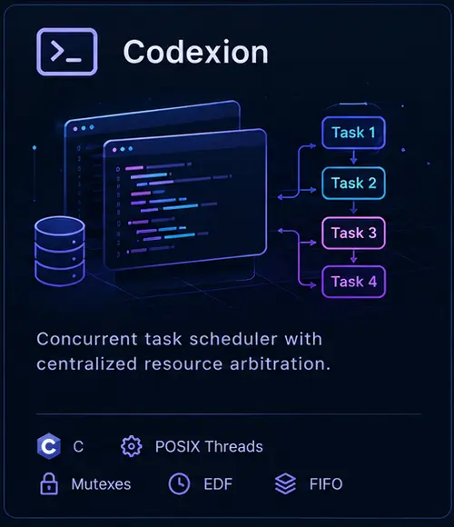
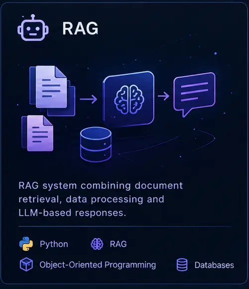
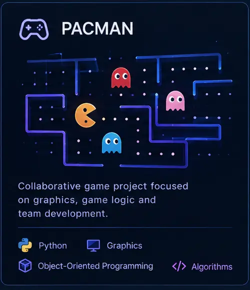
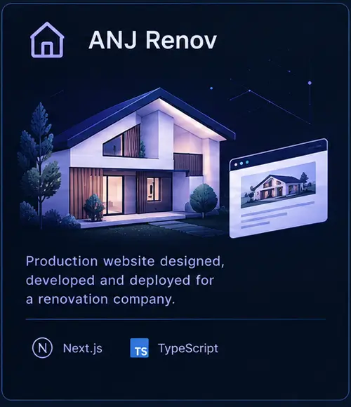

**Desarrolladora de software** en formación en **42 Urduliz Bizkaia — Fundación Telefónica** (Top 3 Ranking WURI 2026).  

Tras varios años de experiencia en **gestión y administración de empresas**, decidí reorientar mi carrera hacia el sector tecnológico, combinando mi experiencia de negocio con el desarrollo de software.

En 42 afronto retos técnicos complejos a través de proyectos prácticos. Desarrollo sistemas concurrentes en C, infraestructuras con Docker y soluciones de inteligencia artificial con Python.

Estoy **abierta a nuevas oportunidades** en el sector tecnológico donde pueda aportar mis conocimientos técnicos y contribuir al desarrollo de soluciones junto a un equipo de IT.

🌍 Idiomas: Francés (nativo) | Español (C1) | Inglés (C1)

🇬🇧 English version

**Software Developer** in Training at **42 Urduliz Bizkaia — Fundación Telefónica** (Top 3 in the WURI 2026 Rankings).

After several years of experience in **business management and administration**, I decided to transition into the tech industry, combining my business background with software development.

At 42, I tackle complex technical challenges through hands-on projects, developing concurrent systems in C, building Docker-based infrastructures, and creating AI solutions with Python.

I am **open to new opportunities** in the tech industry where I can apply my technical skills and contribute to building solutions as part of an IT team.

🌍 **Languages:** French (Native) | Spanish (C1) | English (C1)

🇫🇷 Version française

  
**Software developer** en formation à **42 Urduliz Bizkaia — Fundación Telefónica** (reconnue dans le Top 3 mondial par le classement WURI 2026).

Après plusieurs années d'expérience en gestion et administration d'entreprise, j'ai décidé de réorienter ma carrière vers le secteur technologique, en combinant mon expertise business avec la programmation.

À 42, je relève des défis techniques complexes à travers des projets pratiques. Je développe des systèmes concurrents en C, mets en place des infrastructures avec Docker et conçois des solutions d’intelligence artificielle en Python.

Je suis ouverte à de **nouvelles opportunités dans le secteur technologique**, où je pourrai mettre à profit mes compétences techniques et mon expérience professionnelle, tout en contribuant au développement de solutions au sein d’une équipe IT.

🌍 Langues : Français (langue maternelle) | Espagnol (C1) | Anglais (C1)

---

## 🛠️ Tech Stack

| **Languages** | **Backend** | **Frontend** | **Testing & Code Quality** | **Tools** |
|---------------|-------------|---------|-------------------------------|-----------|
|  |  |  |  |  |
|  |  |  |  |  |
|  |  |  |  |  |
|  |  |  |  |  |
|  |  |  |  |  |

---

## 🧠 Computer Science Fundamentals

---

## 🌟 Featured Projects

<table>
<tr>
<td width="25%" valign="top">

### 🚦 [Codexion](https://github.com/aurelienog/codexion/)  

C • POSIX Threads • Mutexes • EDF • FIFO

</td>

<td width="25%" valign="top">

### 🤖 [RAG](https://github.com/aurelienog/rag)

Python • RAG • OOP • Databases

</td>

<td width="25%" valign="top">

### 🕹️ [PACMAN](https://github.com/aurelienog/pacman/)

Python • Graphics • OOP • Algorithms

</td>

<td valign="top">

### 🏠 [ANJ Renov](https://www.anj-renov.fr/)

Production website.  

Next.js • TypeScript

</td>
</tr>
</table>

---

## 🎓 42 Cursus

Current level: **6.58** (Common Core)

Progress: 🟪🟪🟪🟪🟪🟪⬜⬜⬜⬜ 57%

Highlights:
- ✅ 24 projects
- 🏆 Exam Rank 02 / Exam Rank 03 / Exam Rank 04
- ⏱️ 1200+ hours of coursework

<strong>📚 Completed projects</strong>

 

⭐ = Bonus completed  
🚧 = In progress  
👥 = Group project

 

| Project | Language | Workload | Key concepts |
|---------|----------|:--------:|-------------|
| <a href="https://github.com/aurelienog/the-answer-protocol">The Answer Protocol 👥 🚧</a> |      | 150H | Network & system administration, Graphics, Group |
| <a href="https://github.com/aurelienog/inception/">Inception ⭐</a> |   | 150H | Network & system administration · DB & Data |
| <a href="https://github.com/aurelienog/RAG/">RAG ⭐</a> |   | 150H | Algorithms & AI · OOP |
| <a href="https://github.com/aurelienog/NetPractice/">Netpractice</a> |   | 50H | Network & system administration |
| <a href="https://github.com/aurelienog/pacman/">Pacman 👥</a> |  | 150H | Algorithms & AI · OOP |
| <a href="https://github.com/aurelienog/call-me-maybe/">Call Me Maybe ⭐</a> |  | 80H | Algorithms & AI · OOP |
| <a href="https://github.com/aurelienog/codexion/">Codexion</a> |  | 80H | POSIX Threads · Scheduling |
| <a href="https://github.com/aurelienog/fly-in/">Fly-In ⭐</a> |  | 120H | Space-Time A* |
| <a href="https://github.com/aurelienog/A-Maze-Ing/">A-Maze-ing ⭐ 👥</a> |  | 50H | Prim · DFS · BFS |
| <a href="https://github.com/aurelienog/42-Python-Init/tree/main/python10/">Python Module 10</a> |  | 15H | Functional Programming |
| <a href="https://github.com/aurelienog/42-Python-Init/tree/main/python09/">Python Module 09</a> |  | 15H | Pydantic |
| <a href="https://github.com/aurelienog/42-Python-Init/tree/main/python08/">Python Module 08</a> |  | 15H | Virtual Environments |
| <a href="https://github.com/aurelienog/42-Python-Init/tree/main/python07/">Python Module 07</a> |  | 7H | Design Patterns |
| <a href="https://github.com/aurelienog/42-Python-Init/tree/main/python06/">Python Module 06</a> |  | 7H | Packages & Imports |
| <a href="https://github.com/aurelienog/42-Python-Init/tree/main/python05/">Python Module 05</a> |  | 20H | Abstraction & Polymorphism |
| <a href="https://github.com/aurelienog/42-Python-Init/tree/main/python04/">Python Module 04</a> |  | 6H | File I/O |
| <a href="https://github.com/aurelienog/42-Python-Init/tree/main/python03/">Python Module 03</a> |  | 15H | Data Structures |
| <a href="https://github.com/aurelienog/42-Python-Init/tree/main/python02/">Python Module 02</a> |  | 10H | Exception Handling |
| <a href="https://github.com/aurelienog/42-Python-Init/tree/main/python01/">Python Module 01</a> |  | 10H | Object-Oriented Programming |
| <a href="https://github.com/aurelienog/42-Python-Init/tree/main/python00/">Python Module 00</a> |  | 4H | Python Fundamentals |
| <a href="https://github.com/aurelienog/Born2BeRoot/">Born2beroot</a> |  | 50H | System Administration |
| <a href="https://github.com/aurelienog/42-cursus/tree/main/push_sw/">push_swap 👥</a> |  | 70H | Sorting Algorithms |
| <a href="https://github.com/aurelienog/42-cursus/tree/main/get_next_line/">get_next_line ⭐</a> |  | 55H | File I/O |
| <a href="https://github.com/aurelienog/42-cursus/tree/main/printf/">ft_printf</a> |  | 55H | Variadic Functions |
| <a href="https://github.com/aurelienog/42-cursus/tree/main/Libft/">Libft</a> |  | 70H | C Standard Library |

---

## 📫 Let's connect

- 🌐 [Portfolio](https://aurelie-nogueira.vercel.app/)
- 💼 [LinkedIn](https://linkedin.com/in/aurelie-nogueira)
- 📧 aure.software.dev@gmail.com

---

Always building.  
Always learning.  
